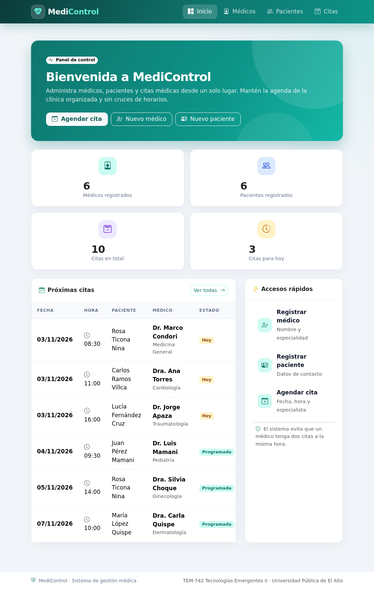

<p align="center">
  
</p>

<h1 align="center">MediControl</h1>

<p align="center">
  Sistema monolítico modular para la gestión de médicos, pacientes y citas médicas.<br>
  <strong>Flask · SQLAlchemy · Flask-Migrate · Bootstrap 5 · SQLite</strong>
</p>

---

## Datos académicos

| | |
|---|---|
| **Universidad** | Universidad Pública de El Alto |
| **Materia** | TEM-742 Tecnologías Emergentes II |
| **Docente** | M. Sc. Mario Torrez C. |
| **Estudiante** | Mayte Mikaela Quispe Perez |
| **Evaluación** | Segundo Parcial — Práctico |
| **Repositorio** | https://github.com/mikaelamay/segundo_parcial_mmqp |

## Descripción

**MediControl** es una aplicación web desarrollada con Flask que implementa el patrón
**Application Factory**, tres Blueprints independientes y una base de datos **SQLite**
versionada mediante migraciones.

El sistema permite:

- Registrar, buscar, editar y eliminar **médicos**.
- Registrar, buscar, editar y eliminar **pacientes**.
- Agendar, filtrar, reprogramar y cancelar **citas médicas**.
- Visualizar un panel con indicadores y próximas citas.
- Evitar citas duplicadas de un mismo médico en la misma fecha y hora.
- Proteger la integridad referencial al impedir la eliminación de médicos o pacientes con citas.

## Tecnologías utilizadas

- Python 3.13
- Flask 3.1
- Flask-SQLAlchemy 3.1
- Flask-Migrate 4.1 (Alembic)
- SQLAlchemy 2.1
- Bootstrap 5 y Bootstrap Icons (guardados localmente en `app/static/vendor`)
- SQLite

## Estructura del proyecto

```text
.
├── app
│   ├── blueprints
│   │   ├── citas
│   │   │   ├── __init__.py
│   │   │   └── routes.py
│   │   ├── medicos
│   │   │   ├── __init__.py
│   │   │   └── routes.py
│   │   ├── pacientes
│   │   │   ├── __init__.py
│   │   │   └── routes.py
│   │   └── __init__.py
│   ├── models
│   │   ├── cita.py
│   │   ├── medico.py
│   │   ├── paciente.py
│   │   └── __init__.py
│   ├── static
│   │   ├── css/styles.css
│   │   ├── img/favicon.svg
│   │   └── vendor/            # Bootstrap local
│   ├── templates
│   │   ├── citas
│   │   ├── medicos
│   │   ├── pacientes
│   │   ├── 404.html
│   │   ├── base.html
│   │   └── index.html
│   ├── __init__.py            # create_app()
│   └── extensions.py          # db y migrate
├── docs
│   ├── capturas/              # 22 capturas del informe
│   ├── terminal/              # salidas reales de comandos
│   ├── Informe_MediControl_Mayte_Quispe_Perez.pdf
│   ├── generar_capturas.py
│   ├── generar_pdf.py
│   └── informe.html
├── instance/                  # base SQLite (no se versiona)
├── migrations/                # migración inicial
├── config.py
├── requirements.txt
├── run.py
└── seed.py
```

## Instalación y ejecución

```bash
# 1. Clonar el repositorio
git clone https://github.com/mikaelamay/segundo_parcial_mmqp.git
cd segundo_parcial_mmqp

# 2. Crear y activar el entorno virtual
python3 -m venv venv
source venv/bin/activate

# 3. Instalar dependencias
pip install -r requirements.txt

# 4. Aplicar las migraciones (crea instance/medicontrol.db)
flask --app run.py db upgrade

# 5. Cargar los datos de prueba
python seed.py

# 6. Ejecutar la aplicación
flask --app run.py run
```

Abrir en el navegador: <http://127.0.0.1:5000>

> La base de datos se crea en `instance/medicontrol.db`. La carpeta `instance/` está
> excluida de Git, por lo que debe generarse con las migraciones y el script de datos.

## Migraciones

```bash
# Inicializar migraciones (solo la primera vez)
flask --app run.py db init

# Generar una nueva migración a partir de los modelos
flask --app run.py db migrate -m "Descripción del cambio"

# Aplicar los cambios a la base de datos
flask --app run.py db upgrade

# Consultar la revisión activa
flask --app run.py db current
```

La migración inicial incluida en el repositorio es
`migrations/versions/2a61b8b3acee_esquema_inicial_medicos_pacientes_y_.py`.

## Rutas principales

| Módulo | Ruta | Operación |
|---|---|---|
| Panel | `GET /` | Indicadores y próximas citas |
| Médicos | `GET /medicos/` | Listado y búsqueda |
| Médicos | `GET/POST /medicos/nuevo` | Crear |
| Médicos | `GET/POST /medicos/<id>/editar` | Editar |
| Médicos | `POST /medicos/<id>/eliminar` | Eliminar |
| Pacientes | `GET /pacientes/` | Listado y búsqueda |
| Pacientes | `GET/POST /pacientes/nuevo` | Crear |
| Pacientes | `GET/POST /pacientes/<id>/editar` | Editar |
| Pacientes | `POST /pacientes/<id>/eliminar` | Eliminar |
| Citas | `GET /citas/` | Listado y filtros |
| Citas | `GET/POST /citas/nueva` | Agendar |
| Citas | `GET/POST /citas/<id>/editar` | Reprogramar |
| Citas | `POST /citas/<id>/eliminar` | Cancelar |

## Datos de prueba

`seed.py` inserta:

- 6 médicos con distintas especialidades.
- 6 pacientes con sus teléfonos.
- 10 citas distribuidas entre fechas pasadas, el día actual y fechas futuras.

Para recargar los datos desde cero:

```bash
python seed.py --reset
```

## Documentación

El informe completo del examen se encuentra en:

**[`docs/Informe_MediControl_Mayte_Quispe_Perez.pdf`](docs/Informe_MediControl_Mayte_Quispe_Perez.pdf)**

Incluye identificación, verificación de requerimientos y capturas de pantalla
explicadas de las cuatro partes del examen.

## Entregables

- [x] Repositorio en GitHub con el código fuente.
- [x] Documento PDF con identificación y capturas de las cuatro partes.
- [x] README con instrucciones de instalación y ejecución.
